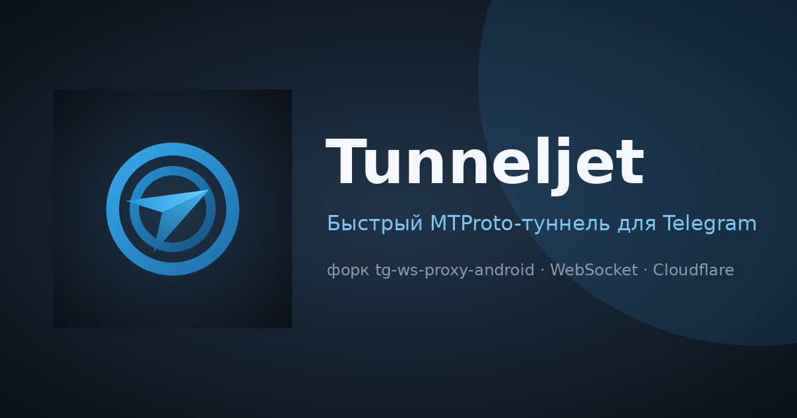

<div align="center">
  
  # Tunneljet
<br>
  
<br>
  
  
  
  <a href="https://github.com/artur0vi4/tunneljet/stargazers">
    
  </a>
</div>
<br>

**Tunneljet** (форк **TG WS Proxy Android**) — это локальный **MTProto-прокси** для Telegram на Android. Приложение помогает частично решать проблемы и в ряде сценариев ускоряет работу мессенджера, перенаправляя трафик через защищённые CloudFlare WebSocket-соединения или напрямую к датацентрам Telegram.

> **Это форк.** Ветка `improved` содержит улучшения поверх оригинального [amurcanov/tg-ws-proxy-android](https://github.com/amurcanov/tg-ws-proxy-android): устойчивость к паникам (краши #288), проверку TLS-сертификатов (MITM), быстрые переподключения на мобильных сетях и экономию батареи. Форк переименован в **Tunneljet**, получил собственную иконку и `applicationId` — ставится параллельно с оригиналом. Полный список изменений — в [FORK.md](FORK.md).

---


## Возможности Android-версии

- **Современный UI/UX:** приложение полностью адаптировано под актуальный Android-интерфейс на базе Material 3 и Jetpack Compose. Основные действия доступны быстро и без перегруженных экранов.
- **Интеграция с Telegram:** кнопка **«Применить в Telegram»** автоматически передаёт прокси в совместимые клиенты через `tg://proxy` (AyuGram, Plus Messenger, NekoGram и другие).
- **Фоновый режим:** используется `Foreground Service`, уведомление о работе сервиса и дополнительная логика удержания соединения, чтобы Android не выгружал прокси слишком агрессивно.
- **Лог-вьюер:** встроенный просмотр событий в реальном времени помогает быстро понять, что происходит с подключением, маршрутом и пулом соединений.
- **Темы и палитры:** поддерживаются Dynamic Colors на Android 12+, а также встроенные палитры для более старых устройств.
- **Авто-обновления внутри приложения:** вручную проверять релизы больше не нужно — когда выйдет новая версия, приложение само покажет уведомление об обновлении.
- **Раздел «Информация»:** внутри приложения есть расширенная справка по настройкам, особенностям CloudFlare, пулу WS-соединений и ручной конфигурации датацентров.

---

## Как это работает

```text
Telegram Android → Локальный MTProto (по умолчанию 127.0.0.1:1443) → Tunneljet → WSS (через CloudFlare или напрямую) → Telegram DC
```

1. Приложение поднимает локальный MTProto-прокси средствами нативного движка на языке **Rust**.
2. Перехватывает подключения Telegram через локальный порт и сгенерированный секретный ключ.
3. Извлекает `DC ID` из исходного пакета и устанавливает защищённое WebSocket (`TLS`) соединение с нужным датацентром, при необходимости проксируя трафик через CloudFlare.
4. Использует пул соединений, keepalive-механику и fallback-сценарии для более устойчивой работы в реальных сетевых условиях.

## Быстрый старт

1. Скачайте актуальный `APK` со **[страницы релизов](https://github.com/artur0vi4/tunneljet/releases)**.
2. Установите приложение на ваш Android-смартфон.
3. Откройте **Tunneljet**.
4. Ознакомьтесь со справкой внутри приложения.
5. Нажмите **«Запустить прокси»** — появится уведомление о работе в фоновом режиме.
6. Нажмите **«Применить в Telegram»** — откроется Telegram-клиент, где останется только подтвердить подключение.

---

# 🎦 Видео гайд по установке и использованию

<div align="center">


<br><br>

[**Смотреть на YouTube**](https://youtu.be/RP4RwyEHpwc) | [**Смотреть в Telegram**](https://t.me/avencoreschat/506796)

</div>

---


* **Краши и проблемы с установкой:** если у вас возникают сбои, вылеты или ошибки при установке, пожалуйста, сохраняйте отчёты и ссылки на них. Также ознакомьтесь с блоком `NOTE` ниже и поднимайте полноценные `issue` с полезной технической информацией.


> [!NOTE]
> ### Отчёты об ошибках
> Приложение адаптировано под мобильные сети, однако проблемы с фоновой работой всё ещё возможны из-за системных ограничений или сети.
>
> Если у вас возникла проблема, сбой или вопрос, пожалуйста, нажмите кнопку **«Собрать отчёт»** внутри приложения и приложите полученные данные к вашему `issue`. Мелкие ошибки в логах при нормально работающем прокси можно игнорировать.

---

## Брендинг

Имя, логотип (туннель + бумажный самолётик), иконки лончера/QS/уведомлений и social-preview — собственные элементы форка. Геометрия задана кодом: `brand/tunneljet_brand.py` единожды генерирует и Android-векторы (`res/drawable`, `res/mipmap-*`), и PNG-превью.

## Лицензия

Этот форк распространяется под лицензией **GPLv3**. Оригинальный код `tg-ws-proxy` от [Flowseal](https://github.com/Flowseal) доступен под лицензией **MIT**.

## Поддержка проекта

Tunneljet — бесплатный проект с открытым кодом. Если приложение сэкономило тебе время и нервы — можно [сказать спасибо](docs/RU/Funding.md).
